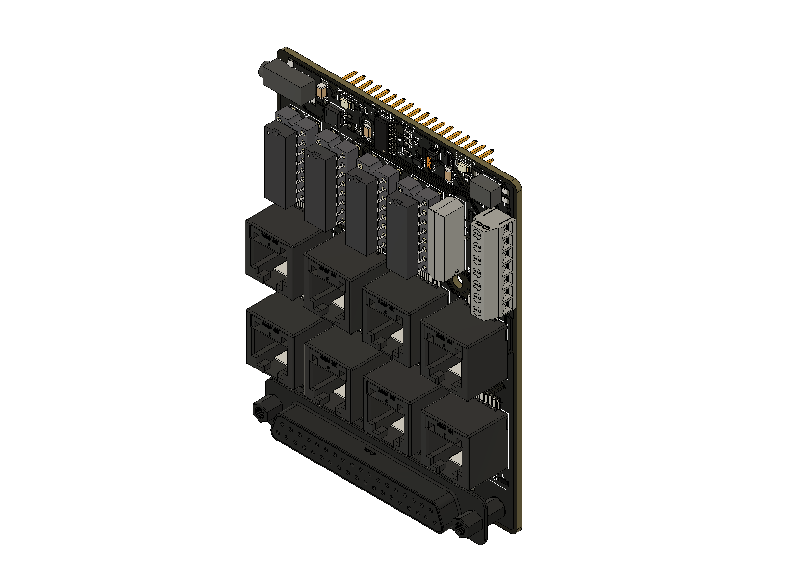

# Changelog

## V2 — more control. Easier troubleshooting. Serviceable drivers.

V2 builds on V1’s eight-axis Dragonframe workflow with **differential motor signals, replaceable line-driver chips, and a clearer view of what every channel is doing**. New relay, logic and pushbutton connections bring more of your rig under Dragonframe control.

This is a hardware upgrade: the changes below describe the **October 16, 2026 socketed DIP design**, compared with the original V1 board. Physical acceptance testing remains pending; this is a design changelog, not a production-release announcement.

### V1 → V2 at a glance

| Feature | V1 | V2 | What you gain |
|---|---|---|---|
| RJ45 motion signals | Single-ended STEP/DIR | Differential STEP+/STEP− and DIR+/DIR− on all eight ports | Paired signals for compatible differential receivers |
| Line-driver service | Two soldered buffer ICs | Four socketed AM26C31 ICs; two axes per chip | Replace a damaged driver chip without soldering |
| Motion activity | One shared activity light | Eight independent STEP lights | See which channel is receiving step activity |
| External contact trigger | No dedicated general-purpose relay | LOG1-controlled dry-contact relay | Trigger a compatible contact-input device |
| Logic trigger | No dedicated terminal output | Buffered LOG2 output | Send events to a compatible logic-input controller |
| External pushbutton | No dedicated switch input | Conditioned SWITCH input | Add a button for a configured Dragonframe action |
| Control connections | Two-pin E-stop connector | Seven-position terminal block | Relay, logic, switch and E-stop connections in one place |
| Status lights | Power, E-stop and shared motion | Power, E-stop, eight STEP, relay, LOG2 and SWITCH | More visibility while setting up and diagnosing a rig |

### Differential outputs on every axis

V1 sends one STEP signal and one DIR signal per RJ45 port. V2 adds an actively driven complementary signal for each, using TI AM26C31 differential line drivers.

With a compatible differential receiver and correctly paired cable, the receiver reads the difference between the two signals. This helps reject noise picked up by both wires—a useful advantage around motor wiring. The benefit depends on the complete cable and receiver setup; no longer-cable distance or higher motion speed is claimed for this prototype. [TI driver reference](https://www.ti.com/product/AM26C31).

The DB37 connection retains single-ended signals for the same eight axes. [See motor-output wiring](hardware/wiring.md#rj45-motor-outputs).

### Replace the chip, keep the board

V2’s four line-driver ICs sit in sockets. If a driver chip is damaged and the board and socket remain intact, it can be replaced without soldering. Each chip serves two axes, making it straightforward to locate the relevant part.

Use **TI AM26C31IN / AM26C31INE4, PDIP-16**. Correct the cause of a failure before fitting a replacement. [Driver map and replacement steps](hardware/driver-replacement.md).

### See activity channel by channel

V1’s shared motion light tells you that some step activity is present. V2 gives each axis its own blue STEP light, so you can check the channel you are jogging without guessing which output is active.

New relay, LOG2 and SWITCH indicators also expose local control activity. These lights help troubleshoot signal paths; they do not confirm motor position or successful external-device operation. [Indicator guide](hardware/indicators.md).

### Bring buttons and external devices into the workflow

The new control terminal adds three useful connections:

- **Relay output:** LOG1 operates a floating contact pair for devices that accept a dry-contact trigger.
- **LOG2 output:** a separate buffered logic signal for compatible trigger inputs, such as an external work-light controller.
- **SWITCH input:** a normally open pushbutton can request an action such as shooting a frame, once enabled in firmware and configured in Dragonframe.

E-stop moves to the same seven-position block. The camera’s separate meter/shutter contact outputs remain available at the camera jack. Relay contacts supply no voltage; LOG2 is a signal output, not power for a lamp. [Connection examples and configuration](setup/triggers.md).

### Under the hood

- **Stock GIGA pin mapping:** STEP/DIR, camera and E-stop connections are aligned with the official dmc-lite GIGA assignments, correcting crossed assignments in the original V1 CAD.
- **Defined driver inputs:** pull-down resistors define STEP/DIR inputs while the GIGA pins float; they do not replace configured stop controls.
- **Four-layer PCB:** dedicated internal ground and +5 V planes replace V1’s two-layer layout.
- **Revised connector layout:** a straight/vertical DB37 and revised camera-jack placement, with the original board outline and GIGA header positions retained. Mounting holes have changed; check existing enclosure fit.
- **Conditioned controls:** the new switch input includes filtering, protection and a Schmitt-trigger buffer; LOG2 uses a buffered output with series resistance and protection.

### What stays familiar

Eight motion axes, Arduino GIGA R1 WiFi, the Dragonframe dmc-lite workflow, eight RJ45 ports, single-ended DB37 output, camera meter/shutter contacts and an E-stop input. External motor drivers still supply motor power. V2 expands the interfaces and serviceability; axis count remains eight.

### Moving from V1

!!! warning "Check existing cables before connecting V2"
    **RJ45 pins 2 and 6 change from ground in V1 to active STEP− and DIR− outputs in V2.** A V1 adapter that grounds these pins can short V2’s outputs. Verify the full cable and receiver pinout before reuse.

1. **Rewire controls using the V2 pinout.** The old two-pin E-stop connector is replaced by J5’s seven-position block. [All connector assignments](hardware/wiring.md).
2. **Check firmware configuration.** V1-specific pin swaps should not be carried forward blindly. SWITCH and E-stop must be explicitly configured; both are disabled in the archived prototype configurations. [Firmware setup](setup/firmware.md).
3. **Check enclosure fit.** The connector layout and mounting holes differ from V1 even though the board outline is retained.
4. **Verify the complete rig.** Check camera cable mapping and receiver compatibility, then follow [first-movement setup](getting-started/overview.md) and [E-stop setup](setup/estop.md).

### Comparison basis

V1: original Fusion PCB v150 / schematic v64. V2: October 16, 2026 socketed DIP PCB v5 / schematic v2. Earlier V2 layout proposals and the separate surface-mount variant are excluded. This comparison was checked against native CAD connectivity and component records on October 22, 2026; board-level load limits, cable limits and operating performance still require physical validation. [Manual sources and verification status](references.md).
