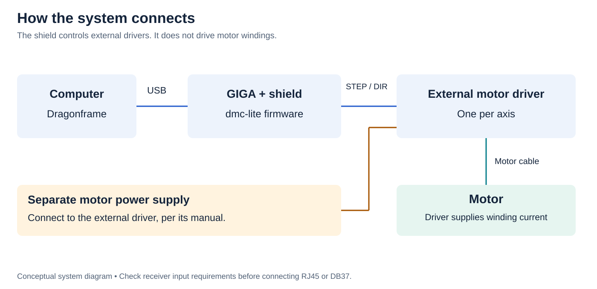
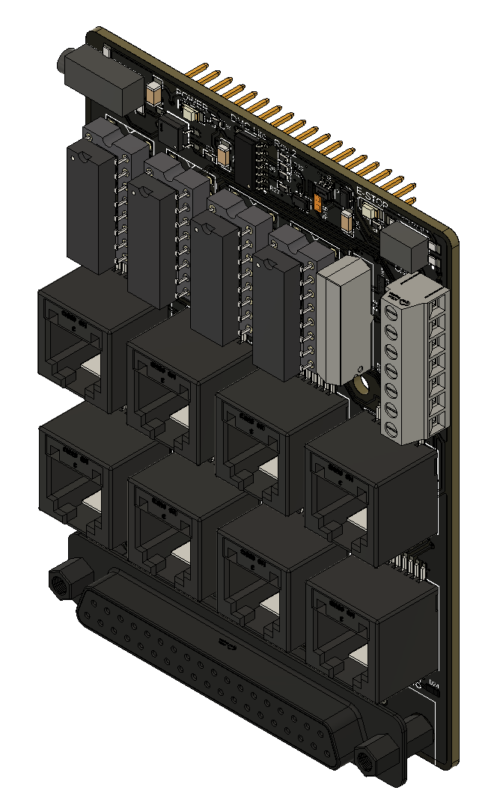

# First setup

1. **Computer → GIGA + shield:** USB data cable; Dragonframe talks to dmc-lite.
2. **Shield → external driver:** STEP/DIR signal cable.
3. **External driver → motor:** motor winding cable.
4. **Separate motor supply → external driver:** follow its manual. The shield does not power motors.

[Open full diagram](../assets/images/system-connections.svg)

## Before connecting

Confirm your board matches the V2 socketed DIP version in this guide. Check the shipment against its packing list and inspect for bent pins, loose ICs or damage. Gather the [required equipment](prerequisites.md).

1. Disconnect USB, GIGA power and motor-driver power. Align all shield headers with the GIGA sockets; check for offset or bent pins before pressing evenly. Do not force it.
2. Confirm the GIGA has a matching pair of dmc-lite firmware sketches. If its configuration is unknown, follow [firmware setup](../setup/firmware.md); do not assume optional inputs are enabled.
3. Select one axis. With everything unpowered, check its cable against the [RJ45 or DB37 pinout](../hardware/wiring.md) and the external driver's manual. Set the driver's motor current and microstepping for your motor.
4. Connect the GIGA to the computer with a USB data cable. Check the green power LED. Leave motor power off while establishing the [Dragonframe connection](../setup/dragonframe.md).
5. Configure and test the [stop input](../setup/estop.md) and your rig's independent means of stopping motion. Keep travel clear; support loads that could fall.
6. Enable motor power. Jog one axis at low speed over a short distance. Check channel, direction, distance and stop behavior before increasing speed or adding axes.
7. Add [triggers and switches](../setup/triggers.md) individually, testing each without its final load first.

A channel LED means STEP signal activity. It does not prove that the motor moved or reached its intended position.

## Board in three dimensions

