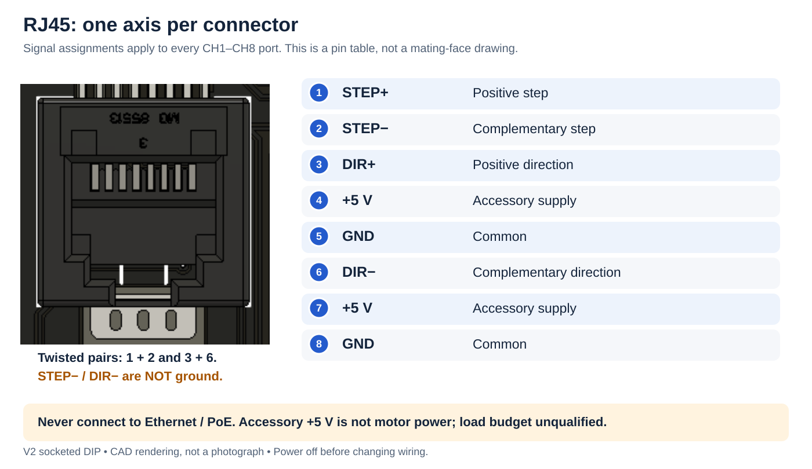
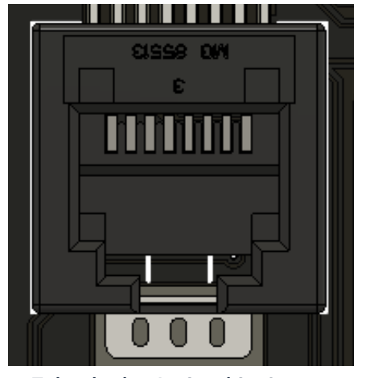
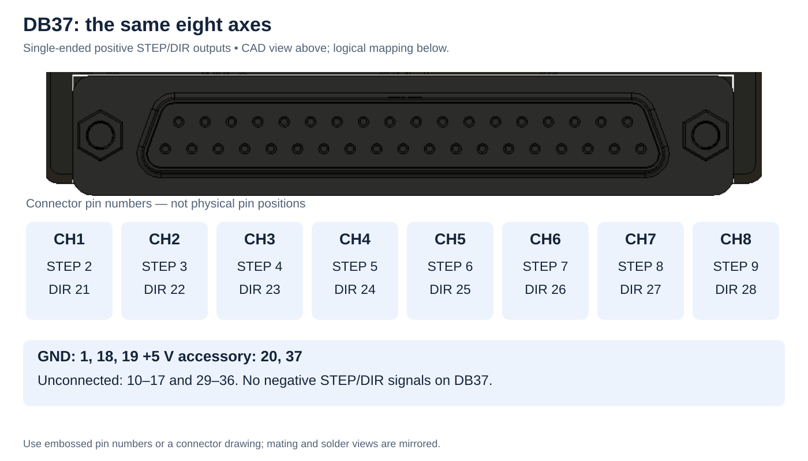
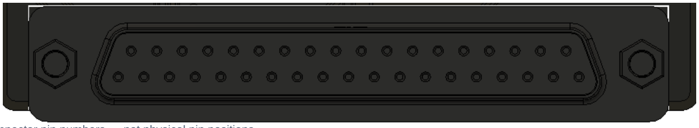
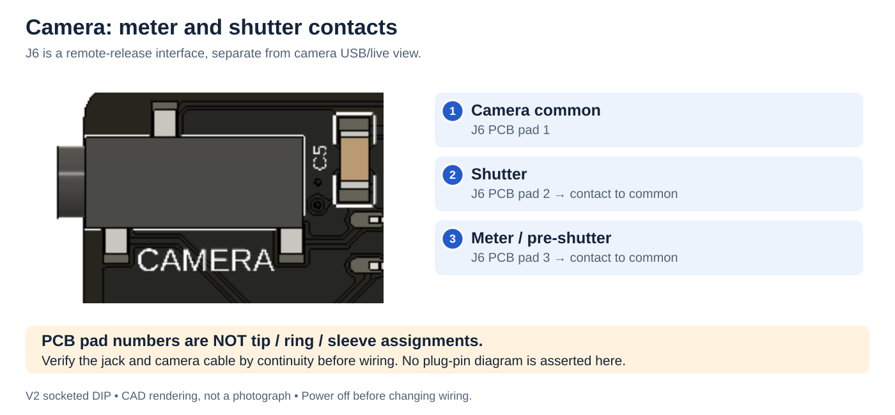
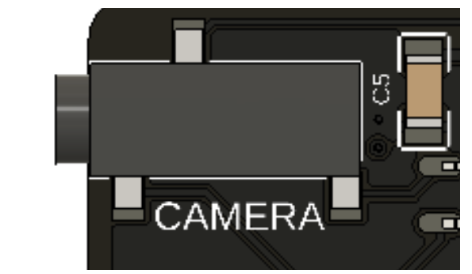

# Pinouts and wiring

**Power off before wiring.** Pin numbers below are connector/CAD pin numbers, not an instruction to count left-to-right. Mating-face and solder-side views are mirrored. The J5 close-up identifies its top-view numbering. RJ45 and DB37 figures are function maps, not mating-face pin diagrams: identify their numbered contacts from the connector drawing or continuity-check with power disconnected. If you cannot establish pin 1, do not guess.

1. **Camera:** J6 meter and shutter contacts.
2. **Drivers:** U1/U2/U5/U6, two axes per IC.
3. **Controls:** J5 relay, LOG2 and switch inputs.
4. **RJ45:** eight motor-signal ports, never Ethernet.
5. **DB37:** the same eight axes, single-ended.
6. **Lights:** power, STEP and control activity.

[Open full diagram](../assets/images/board-tour.svg)

## RJ45 motor outputs

| Pin | Signal |
|---|---|
| 1 | STEP+ |
| 2 | STEP− |
| 3 | DIR+ |
| 4 | +5 V accessory |
| 5 | GND |
| 6 | DIR− |
| 7 | +5 V accessory |
| 8 | GND |

Twisted pairs: **1/2 and 3/6**. Negative outputs are not ground. This is a function table, not a mating-face drawing. Never connect Ethernet/PoE.

[Open full diagram](../assets/images/rj45-pinout.svg)

RJ45_1 serves channel 1, through RJ45_8 for channel 8. Every jack uses the same assignment:

| Pin | Signal | Purpose |
|---:|---|---|
| 1 | STEP+ | Positive step output |
| 2 | STEP− | Complementary step output |
| 3 | DIR+ | Positive direction output |
| 4 | +5 V | Accessory supply; load budget unqualified |
| 5 | GND | Signal/power common |
| 6 | DIR− | Complementary direction output |
| 7 | +5 V | Same accessory supply |
| 8 | GND | Signal/power common |

**Never connect these to Ethernet, a network switch or PoE.** STEP− and DIR− are actively driven signals, not ground. Use twisted pairs for pins 1/2 and 3/6 with a differential receiver. Follow the external driver's manual for optocoupled or single-ended inputs; do not automatically ground the negative outputs.

The signal assignment follows the DMC-32 motion connector convention, but a cable is usable only when its far end matches your receiver. Verify continuity, input loading and grounding before power-up. Do not connect the same channel through RJ45 and DB37 to multiple loads without checking combined loading.

## DB37 motor outputs

For channels **1–8**, STEP+ uses pins **2–9** and DIR+ uses **21–28**, in channel order.

**GND:** 1, 18, 19. **+5 V accessory:** 20, 37.

**Unconnected:** 10–17, 29–36. No negative STEP/DIR outputs. Identify physical pin numbers from the connector drawing.

[Open full diagram](../assets/images/db37-pinout.svg)

DB37 carries the same eight channels in single-ended form. It does not provide the negative signals.

| Channel | STEP+ pin | DIR+ pin |
|---:|---:|---:|
| 1 | 2 | 21 |
| 2 | 3 | 22 |
| 3 | 4 | 23 |
| 4 | 5 | 24 |
| 5 | 6 | 25 |
| 6 | 7 | 26 |
| 7 | 8 | 27 |
| 8 | 9 | 28 |

| Other pins | Function |
|---|---|
| 1, 18, 19 | GND |
| 20, 37 | +5 V accessory supply |
| 10–17, 29–36 | Unconnected |

Check any legacy/Kuper adapter pin-by-pin. There is no charge-pump output, limit-input bank or driver-fault return on this connector.

## J5: seven-position control terminal

**Top to bottom, in this board view:**

| Pin | Connection |
|---|---|
| 7 | GND |
| 6 | E-stop contact to GND |
| 5 | SWITCH: normally open button to GND |
| 4 | RELAY−: floating contact B |
| 3 | RELAY+: floating contact A |
| 2 | LOGIC: LOG2 output |
| 1 | GND |

**Relay contacts supply no voltage.** LOG1 controls the pair; LOG2 is separate.

[Open full diagram](../assets/images/control-terminal.svg)

| Pin | Label/function | Connect to |
|---:|---|---|
| 1 | GND | Logic/switch common |
| 2 | LOG2 | Compatible logic-trigger input; use GND as reference |
| 3 | Relay IN | One side of the external device's dry-contact input |
| 4 | Relay OUT | Other side of that contact input |
| 5 | SWITCH | Normally open pushbutton to pin 1 or 7 |
| 6 | E-stop | Stop contact to pin 1 or 7; polarity depends on firmware |
| 7 | GND | Logic/switch common |

Relay IN/OUT are the two ends of a floating contact. Neither supplies a voltage; neither is a required ground. LOG1 controls this relay, and LOG2 controls pin 2. There is no separate LOG1 terminal in addition to the relay.

See [trigger examples](../setup/triggers.md) and [E-stop configuration](../setup/estop.md) before connecting a device. Do not apply external voltage to SWITCH or E-stop; these connections expect contacts to ground.

## J6: camera remote release

J6 provides isolated contact closures for a camera remote-release interface:

| PCB contact | Function |
|---:|---|
| 1 | Camera common |
| 2 | Shutter contact to common |
| 3 | Meter / pre-shutter contact to common |

These are **PCB pad assignments, not verified tip/ring/sleeve assignments**. The jack is SJ-2523-SMT-TR. A cable must be checked against its drawing, continuity measurements and the camera's remote-release manual before use. Do not use this table alone to solder a plug. Camera-common is not a request to connect to the shield's logic GND.

**J6 PCB pads:** 1 common, 2 shutter, 3 meter/pre-shutter.

These are contact closures to camera common. **Not verified tip/ring/sleeve assignments.** Check the cable before wiring.

[Open full diagram](../assets/images/camera-contacts.svg)

A remote-release connection does not provide live view or image transfer. Follow [Dragonframe's camera setup](https://www.dragonframe.com/camera-support/) for the camera's USB connection and capture settings.

## GIGA signals for firmware configuration

| Function | GIGA pins |
|---|---|
| STEP 1–8 | D22, D24, D26, D28, D30, D32, D34, D36 |
| DIR 1–8 | D23, D25, D27, D29, D31, D33, D35, D37 |
| LOG1 / relay | D40 |
| LOG2 | D41 |
| E-stop input | D48 |
| SWITCH input | D49 |
| Camera meter / shutter | D52 / D53 |

These numbers describe the V2 wiring. Do not reuse a V1 pin-swapped firmware configuration.
