---
hide:
  - navigation
  - toc
---

# DMC Lite Shield owner's guide

This guide covers the **V2 socketed DIP board** and Arduino GIGA R1 WiFi.

**What’s new in V2?** Differential outputs, replaceable drivers, per-axis lights and expanded trigger controls. [Compare V1 and V2 in the changelog](changelog.md).

## Start here: your first motor movement

1. **[Connect the hardware](getting-started/overview.md).** Check cables and mount the shield with all power disconnected. Keep motor power off.
2. **[Flash the Arduino](setup/firmware.md).** Find Dragonframe’s sketches and upload both M7 and M4.
3. **[Connect Dragonframe and jog one axis](setup/dragonframe.md).** Verify stop behavior, then test a short, slow move.

**Before wiring:** RJ45 is not Ethernet. The shield sends signals; external drivers supply motor power.

Already set up? [Board tour](#meet-your-board) · [LED meanings](#what-does-that-light-mean) · [Pinouts](hardware/wiring.md) · [Troubleshooting](troubleshooting.md)

## Meet your board

[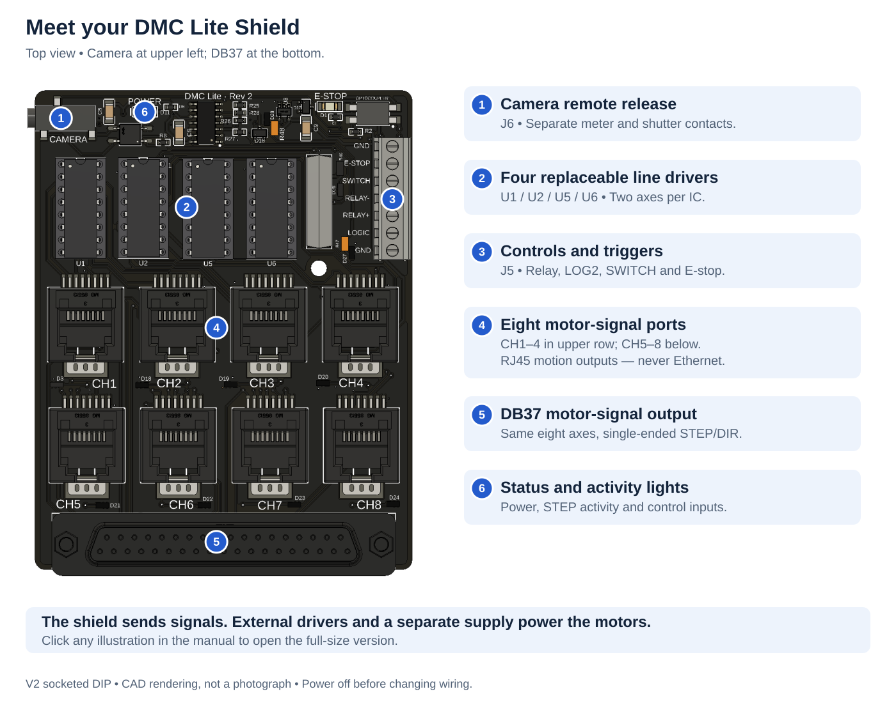](assets/images/board-tour.svg)

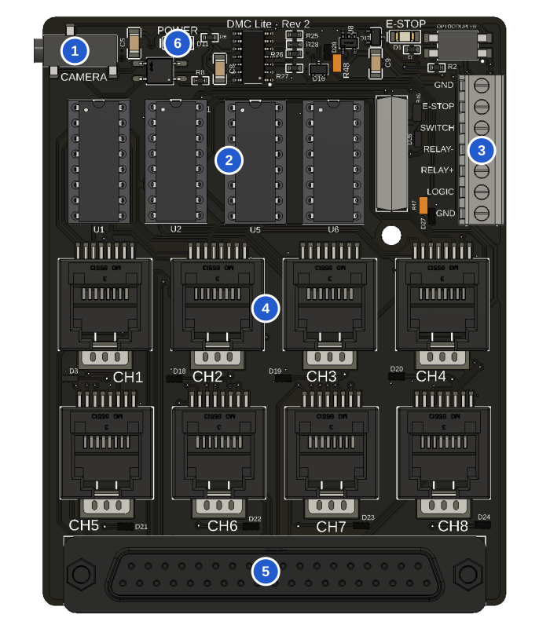

1. **Camera:** J6 meter and shutter contacts.
2. **Drivers:** U1/U2/U5/U6, two axes per IC.
3. **Controls:** J5 relay, LOG2 and switch inputs.
4. **RJ45:** eight motor-signal ports, never Ethernet.
5. **DB37:** the same eight axes, single-ended.
6. **Lights:** power, STEP and control activity.

[Open full diagram](assets/images/board-tour.svg)

[Start with one axis](getting-started/overview.md) · [All pinouts](hardware/wiring.md) · [Troubleshooting](troubleshooting.md)

## Find the main connectors and components

The highlighted parts keep their original appearance; the surrounding board fades into the background. Tap a view to enlarge.

[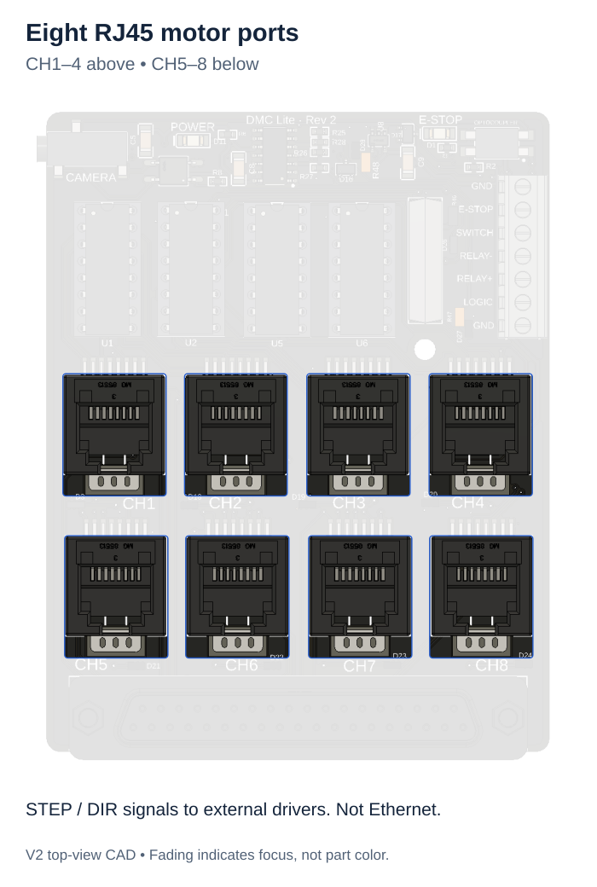](assets/images/focus-rj45.svg)

**Eight RJ45 motor ports.** CH1–4 above, CH5–8 below. STEP/DIR to external drivers; never Ethernet.

[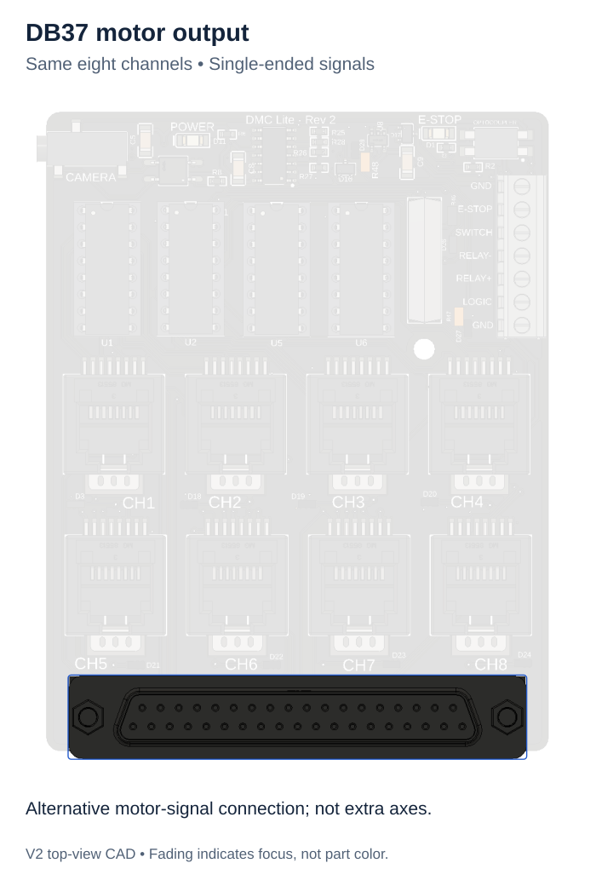](assets/images/focus-db37.svg)

**DB37 motor output.** The same eight axes, with single-ended signals.

[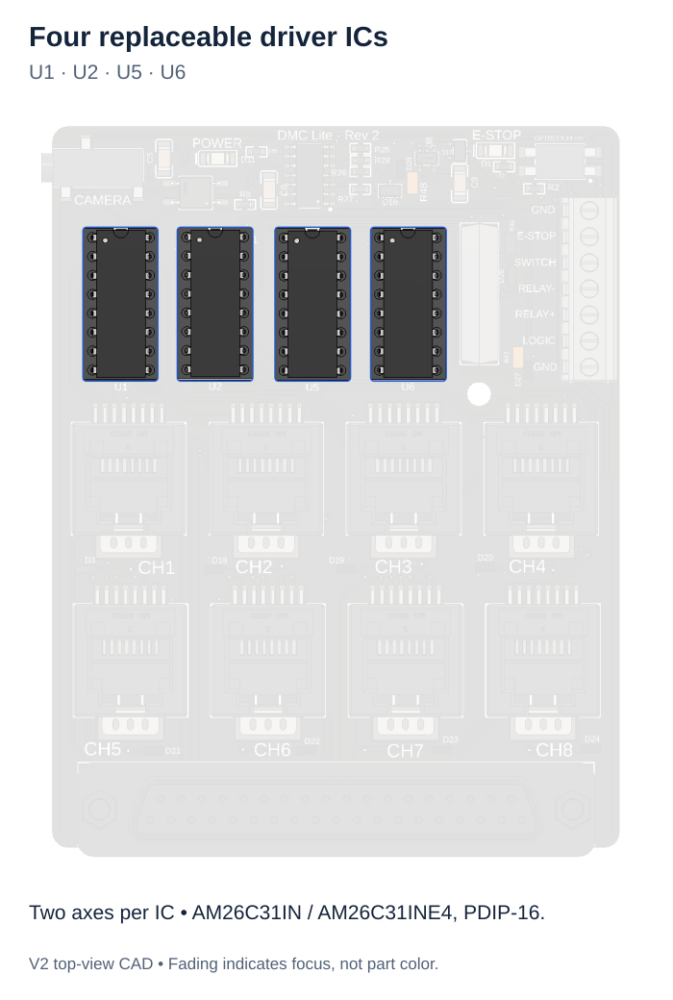](assets/images/focus-drivers.svg)

**Four replaceable driver ICs.** U1, U2, U5, U6. Two axes per IC; use AM26C31IN / AM26C31INE4 PDIP-16.

[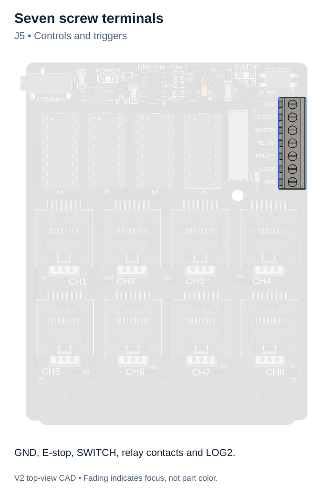](assets/images/focus-terminal.svg)

**Seven screw terminals.** J5: GND, E-stop, SWITCH, relay contacts and LOG2.

[Connector pinouts](hardware/wiring.md) · [Driver replacement](hardware/driver-replacement.md) · [Trigger wiring](setup/triggers.md)

## What does that light mean?

[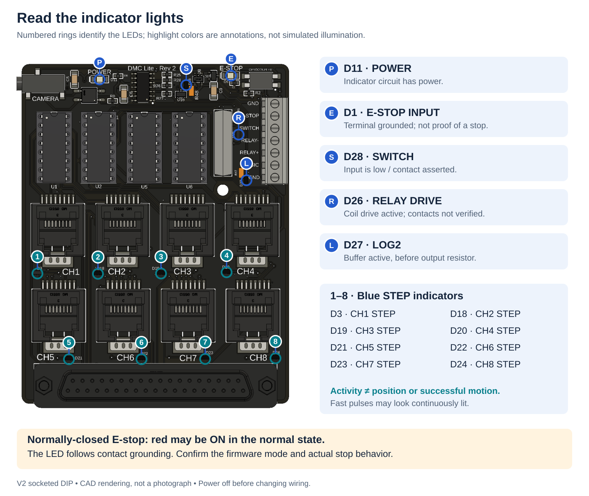](assets/images/led-map.svg)

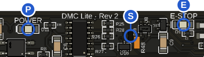

**P — Power (D11):** indicator circuit powered.

**E — E-stop (D1):** terminal grounded, not proof of stopping.

**S — SWITCH (D28):** contact asserted / input low.

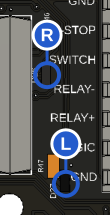

**R — Relay (D26):** coil drive active; contacts not verified.

**L — LOG2 (D27):** buffer active before its output resistor.

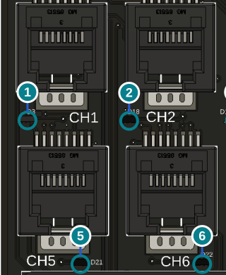

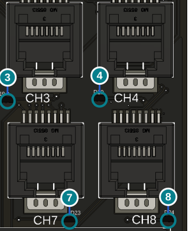

**1–8 — STEP activity:** D3, D18, D19, D20, D21, D22, D23, D24 respectively. Activity is not motor-position feedback.

**NC E-stop:** the red light may be on during normal operation. Verify firmware mode.

[Open full diagram](assets/images/led-map.svg)

[Read the indicator guide](hardware/indicators.md). The red E-stop light follows the contact state; it does not certify that motion has stopped.

## Connect buttons, triggers and the relay

[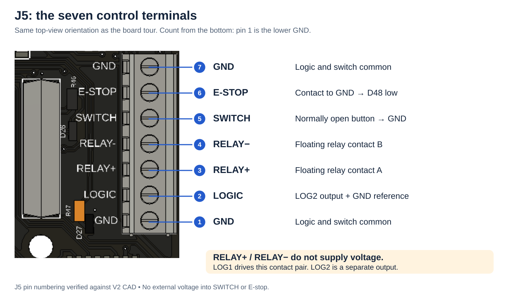](assets/images/control-terminal.svg)

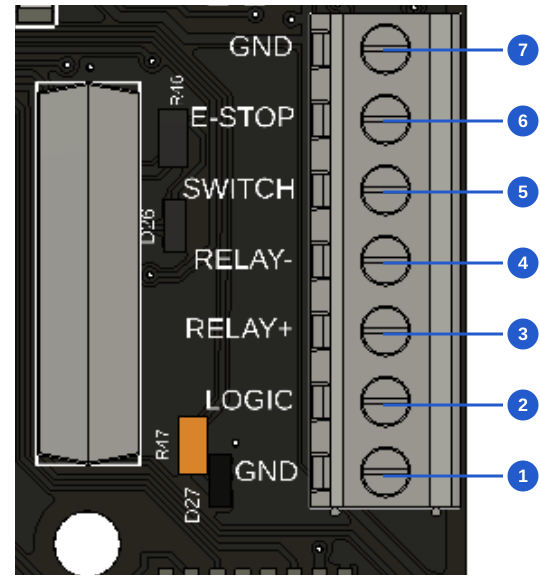

**Top to bottom, in this board view:**

| Pin | Connection |
|---|---|
| 7 | GND |
| 6 | E-stop contact to GND |
| 5 | SWITCH: normally open button to GND |
| 4 | RELAY−: floating contact B |
| 3 | RELAY+: floating contact A |
| 2 | LOGIC: LOG2 output |
| 1 | GND |

**Relay contacts supply no voltage.** LOG1 controls the pair; LOG2 is separate.

[Open full diagram](assets/images/control-terminal.svg)

[Wiring examples and Dragonframe events](setup/triggers.md) · [Stop-button setup](setup/estop.md)

## Replace a damaged driver

[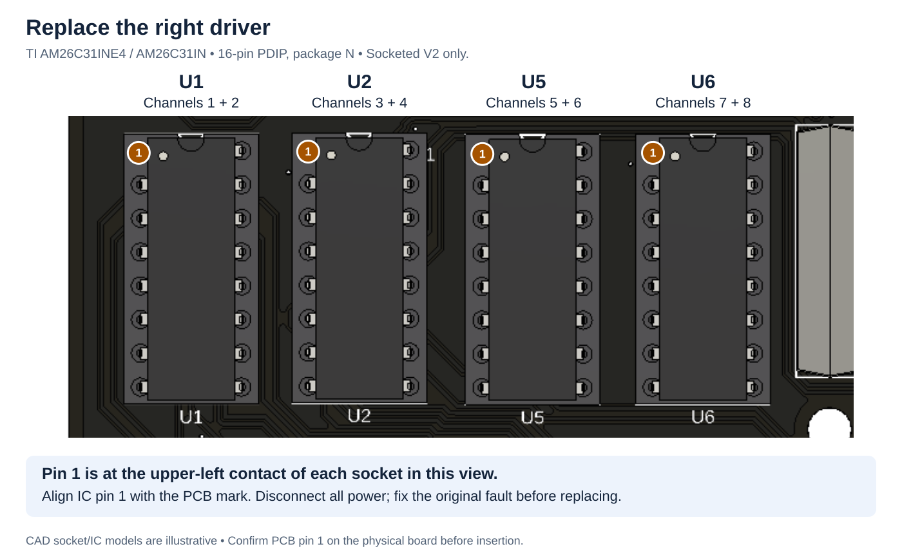](assets/images/driver-map.svg)

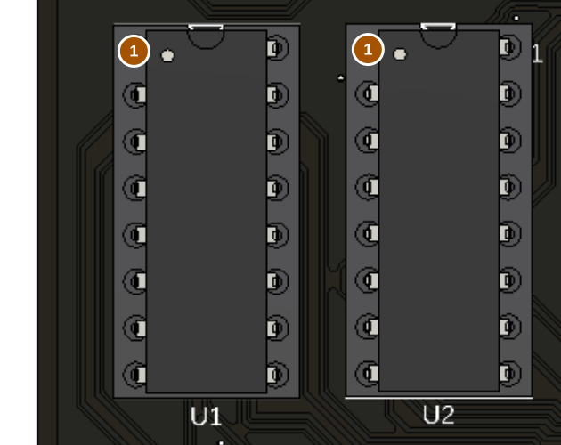

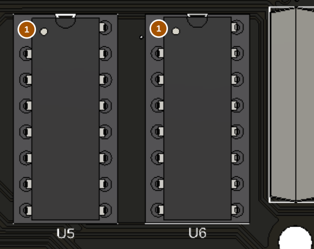

| IC | Channels |
|---|---|
| U1 | 1 + 2 |
| U2 | 3 + 4 |
| U5 | 5 + 6 |
| U6 | 7 + 8 |

**Pin 1:** upper-left socket contact in these views. Verify the physical PCB marking.

**Replacement:** TI AM26C31IN / AM26C31INE4, 16-pin PDIP (N). Disconnect power first.

[Open full diagram](assets/images/driver-map.svg)

Buy **TI AM26C31INE4 / AM26C31IN, 16-pin PDIP (N)** for this socketed version. [Follow the replacement procedure](hardware/driver-replacement.md) before removing a chip.

## Put the Dragonframe sketch on the Arduino

[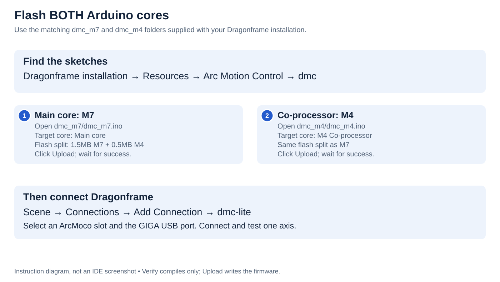](assets/images/flashing-workflow.svg)

1. **Find sketches:** Dragonframe installation → Resources → Arc Motion Control → dmc.
2. **Upload M7:** open `dmc_m7.ino`; target **Main core**.
3. **Upload M4:** open matching `dmc_m4.ino`; target **M4 Co-processor**.
4. For both: **1.5MB M7 + 0.5MB M4** flash split. Click **Upload**, not just Verify.
5. **Connect:** Scene → Connections → dmc-lite; choose ArcMoco slot and GIGA port.

[Open full diagram](assets/images/flashing-workflow.svg)

[Open the step-by-step flashing guide](setup/firmware.md) for macOS, Windows and Linux folder navigation, IDE settings and troubleshooting.

## Before you power up

The shield sends control signals; external drivers supply motor power. **RJ45 is not Ethernet.** Disconnect power before changing cables or removing ICs.

These are CAD views of the October 16, 2026 V2 socketed DIP design. They do not document assembly or operating tests. First-board acceptance results, delivered firmware configuration and camera plug wiring remain unconfirmed. V1 and surface-mount versions need their own instructions. [Sources and illustration notes](image-plan.md).
