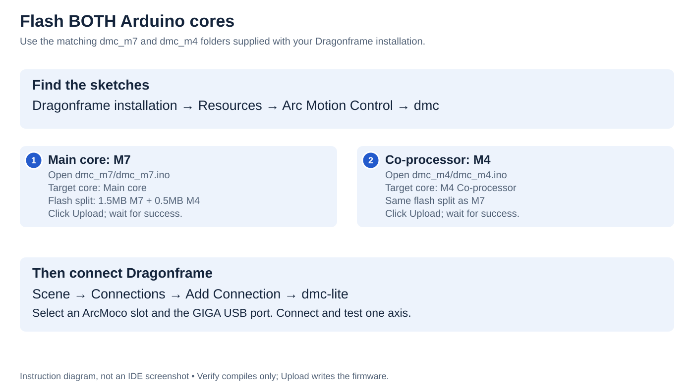

# Flash the Arduino with Dragonframe dmc-lite

The **Arduino GIGA**, not the shield itself, runs Dragonframe's **dmc-lite** firmware. It needs two matching sketches: `dmc_m7` and `dmc_m4`. The older `DFMoco` sketch is different.

If your GIGA arrived configured, record its firmware version and input options before changing anything. The first prototype's installed firmware has not yet been recorded; this guide does not certify a pre-flashed image.

<div class="guide-desktop" markdown>

[](../assets/images/flashing-workflow.svg)

</div>

<div class="guide-mobile" markdown>


1. **Find sketches:** Dragonframe installation → Resources → Arc Motion Control → dmc.
2. **Upload M7:** open `dmc_m7.ino`; target **Main core**.
3. **Upload M4:** open matching `dmc_m4.ino`; target **M4 Co-processor**.
4. For both: **1.5MB M7 + 0.5MB M4** flash split. Click **Upload**, not just Verify.
5. **Connect:** Scene → Connections → dmc-lite; choose ArcMoco slot and GIGA port.

[Open full diagram](../assets/images/flashing-workflow.svg)

</div>


## 1. Find the sketches on your computer

Install Dragonframe first. Its official dmc-lite sketches are included in:

```text
[Dragonframe installation folder]/Resources/Arc Motion Control/dmc/
```

This location is documented by [Dragonframe](https://www.dragonframe.com/ufaqs/what-hardware-is-compatible-with-dragonframe-motion-control-workspace/). Use the installation folder, not the folder where you save scenes or captured images.

### macOS

In Finder, open **Applications → Dragonframe 2026 → Resources → Arc Motion Control → dmc**. On the inspected installation, you can also press **Shift–Command–G** in Finder and paste:

```text
/Applications/Dragonframe 2026/Resources/Arc Motion Control/dmc/
```

Replace `Dragonframe 2026` with your installed version's folder name if different. This verified path is inside the Dragonframe installation folder; you do not need to open the application's package contents for this layout.

### Windows

Find the folder containing your installed Dragonframe program. You can right-click its shortcut, open **Properties**, and use **Open File Location** to locate the executable. If a Start-menu shortcut takes you to another shortcut, open that shortcut's file location too.

From the installation folder, open **Resources → Arc Motion Control → dmc**. The installation may be under `C:\Program Files`, but the folder name and location depend on the version and installer choices; use your actual installation rather than a hard-coded path.

### Linux

Open the directory where Dragonframe is installed, then **Resources → Arc Motion Control → dmc**. For a packaged installation, use your package manager's installed-file listing to locate `dmc_m7.ino` if the installation directory is unclear. There is no single Linux installation path assumed by this guide.

### Check the folder contents

You should find at least:

```text
dmc/
├── README.rtf
├── dmc_m7/
│   ├── dmc_m7.ino
│   └── config.h
└── dmc_m4/
    ├── dmc_m4.ino
    └── config.h
```

Other supporting files must stay in place. Some manual editions call the folder `dmc-lite`; look for the matching `dmc_m7` and `dmc_m4` folders. If necessary, search your Dragonframe installation for `dmc_m7.ino`. A `DFMoco.ino` file is a different firmware and is not the one to use here.

Read the included **README.rtf**, then copy the **entire dmc folder** to a writable location such as Documents. Work from this copy so edits survive separately from application updates. Keep the two sketch folders together from the same release; do not copy only the `.ino` files.

> **Image placeholder — finding the sketches:** Finder and File Explorer views showing the Dragonframe installation, `Resources/Arc Motion Control/dmc`, README and both sketch folders. Label the operating system and Dragonframe version.

## 2. Prepare Arduino IDE and the GIGA

1. Install [Arduino IDE](https://www.arduino.cc/en/software/), then open **Tools → Board → Boards Manager** (or the Boards Manager sidebar).
2. Search for **Arduino Mbed OS Giga Boards** and install it. The archived V2 sketches compile with version **4.5.0**; that is the recorded build baseline, not a hardware-test result.
3. Disconnect motor-driver power and external trigger loads. Connect the GIGA's **USB-C** port to your computer with a data cable.
4. Select **Tools → Board → Arduino Mbed OS Giga Boards → Arduino GIGA R1**. Select the connected board under **Tools → Port**; the port name differs by computer. If unclear, compare the port list before and after connecting the board.
5. Close Dragonframe's connection to the board and any Serial Monitor using the port.
6. Before uploading, review the [V2 input settings below](#v2-input-and-output-settings). Enable/configure SWITCH and E-stop if you intend to use them.

## 3. Flash the M7 main core

1. In Arduino IDE choose **File → Open** and open `dmc_m7/dmc_m7.ino` from your working copy.
2. Confirm the GIGA board and USB port are selected.
3. Set **Tools → Target core → Main core**.
4. Set **Tools → Flash split → 1.5MB M7 + 0.5MB M4**.
5. Click **Upload** (right-arrow button). Wait for compilation and upload to finish successfully. **Verify** (check-mark button) only compiles; it does not flash the board.

## 4. Flash the M4 co-processor

1. Open `dmc_m4/dmc_m4.ino` from the **same working copy**.
2. Check the GIGA board and port again; IDE windows can retain different selections.
3. Set **Tools → Target core → M4 Co-processor**.
4. Keep **Tools → Flash split → 1.5MB M7 + 0.5MB M4**.
5. Click **Upload** and wait for successful completion.

| Sketch | Target core | Flash split |
|---|---|---|
| `dmc_m7.ino` | Main core | 1.5MB M7 + 0.5MB M4 |
| `dmc_m4.ino` | M4 Co-processor | 1.5MB M7 + 0.5MB M4 |

**Both uploads are required.** Uploading a sketch to the wrong core or mixing releases does not produce a working matched pair. These steps follow Dragonframe's supplied README; consult it if your release uses different menu wording.

> **Image placeholder — upload settings:** one Arduino IDE view for each sketch, with board, target core, flash split, port and Upload button highlighted. Show the successful upload result separately from compile-only success.

## 5. Connect and check

Close Serial Monitor. Reconnect/reset as directed by the supplied README, then open Dragonframe: **Scene → Connections → Add Connection → dmc-lite**, select an ArcMoco slot and the GIGA port, then **Connect**. Follow the [first-axis setup](dragonframe.md) before enabling normal motion.

Record your Dragonframe release, Arduino board-core version and enabled input options. Keep your working copy as the firmware configuration record.

## If flashing fails

| Problem | Check |
|---|---|
| No GIGA port | Use a USB data cable and the GIGA USB-C connector; try another computer USB port |
| Port busy | Disconnect Dragonframe and close Serial Monitor or other serial applications |
| Target core or flash split missing | Confirm GIGA board support is installed and Arduino GIGA R1 is selected |
| Missing files during compilation | Restore the complete sketch folders and supporting files from the same Dragonframe installation |
| Upload succeeds but no connection | Confirm **both** sketches were uploaded to their respective cores with the specified split |

If the GIGA cannot accept an upload, follow [Arduino's GIGA recovery guidance](https://docs.arduino.cc/tutorials/giga-r1-wifi/cheat-sheet). Double-pressing **RST** enters its bootloader/DFU mode; recheck the port before retrying. Do not change wiring or firmware pin assignments to solve a USB upload failure.

## V2 input and output settings

Open **`dmc_m7.ino`**, then its **`config.h`** tab. Find `#ifdef ARDUINO_ARCH_MBED_GIGA` near the top. Make the following changes there, not in the Portenta section.

### E-stop and external button

Remove the leading `//` from the existing lines for the inputs you want to use:

```cpp
#define KILL_SWITCH_PIN D48
#define LOGIC_SWITCH_PIN D49
```

Do not duplicate the definitions. These options are disabled in the archived prototype configurations.

| Input | Connection | What happens |
|---|---|---|
| E-stop, normally open | J5 **6** → stop contact → GND **1 or 7** | Closing the contact requests a stop |
| External button, normally open | J5 **5** → button → GND **1 or 7** | Pressing requests the action selected in **Scene → Triggers** |

Use voltage-free contacts; do not feed external voltage into these inputs.

**If your E-stop contact is normally closed:** use the official Dragonframe 2026 matched sketches and also uncomment:

```cpp
#define KILL_SWITCH_NORMALLY_CLOSED 1
```

Opening the contact then requests the stop. Leave that line commented for normally-open wiring. The older local prototype sketch does not implement this option; adding the line there will not enable it. Use the supported sketch pair instead. See [E-stop setup](estop.md) and check the actual contact behavior before moving motors.

### What needs no extra enable setting

| Feature | Sketch setting / action |
|---|---|
| LOG1 relay | Keep `#define LOGIC_OUT_0 D40`; choose its output event in Dragonframe |
| LOG2 trigger | Keep `#define LOGIC_OUT_1 D41`; choose its output event in Dragonframe |
| Differential motor outputs | Hardware handles this; use the standard V2 STEP/DIR pins |
| Activity and control LEDs | Hardware-driven; no sketch change |
| Camera meter / shutter | Keep the standard M4 assignments: D52 / D53 |

No M4 edits are needed to enable these features. V2 uses STEP D22/D24…D36 and DIR D23/D25…D37. Do not use the older V1 pin-swapped configuration. See the [full pin mapping](../hardware/wiring.md#giga-signals-for-firmware-configuration).

### Upload after editing

With motor power off, save and **Upload** M7 with **Target core → Main core** and **Flash split → 1.5MB M7 + 0.5MB M4**. Verify alone does not install the changes.

For a fresh setup or a firmware version change, upload the matching M4 as described above. If that matching M4 is already installed, changing only these M7 settings requires only the M7 upload. Reconnect Dragonframe and try the inputs before normal motion.

## Verify the installation

A serial connection is only the first check. Test each axis slowly in both directions, stop contact open/closed/disconnected, SWITCH action, relay closure, LOG2 and camera contacts before using the rig. A lit input LED does not prove the corresponding firmware option is enabled.

For updates, save your current configuration, read the new release's README and repeat both uploads and the operating checks. Obtain software from [Dragonframe](https://www.dragonframe.com/downloads/) and GIGA setup guidance from [Arduino](https://docs.arduino.cc/hardware/giga-r1-wifi/).
