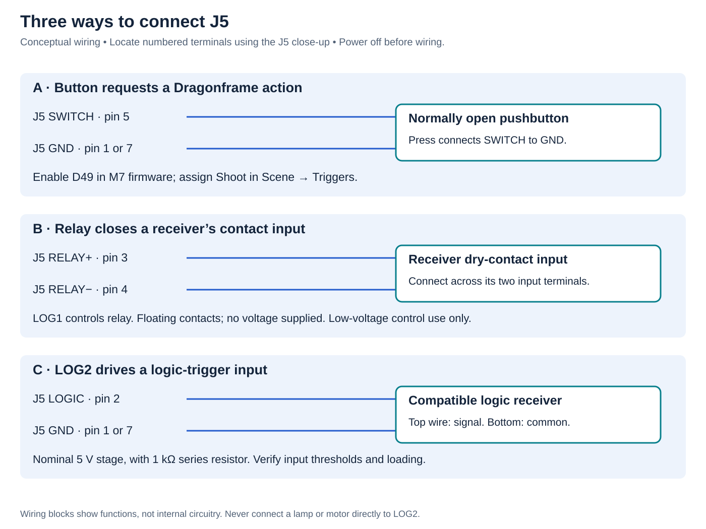

# Triggers, switches and relay

A trigger **output** tells another device when a Dragonframe event occurs. The SWITCH **input** lets a pushbutton request an action in Dragonframe. The E-stop input has a separate purpose; see [E-stop](estop.md).

## Choose the right connection

| Task | Shield connection | Electrical behavior |
|---|---|---|
| Device expects a switch/contact closure | J5 pins 3 and 4, relay | Floating contact controlled by LOG1 / D40 |
| Device expects a logic-level trigger | J5 pin 2 LOG2, plus pin 1 or 7 GND | Buffered signal from D41, nominal 5 V stage with 1 kΩ series resistance |
| Pushbutton requests a Dragonframe action | J5 pin 5 SWITCH to pin 1 or 7 GND | Normally open contact; closure asserts D49 low |
| Camera remote meter/shutter | J6 camera jack | Separate contact closures; see [camera wiring](../hardware/wiring.md#j6-camera-remote-release) |

*Tap or click to enlarge.*

## Connect Dragonframe first

Follow [Dragonframe setup](dragonframe.md), then open **Scene → Triggers**. The 2026 user guide describes inputs and outputs in chapter 15, printed pages 263–268; DMX trigger programming is on pages 234–235. Get the manual matching your installation from **Help** or [Dragonframe support](https://www.dragonframe.com/support/).

That chapter primarily illustrates other Dragonframe controllers. This shield converts **LOG1 to a mechanical relay** and exposes **LOG2 as logic**. Do not assume a panel labeled “External Switch (Relay)” maps to this board's relay. On the connected dmc-lite, test each available logic output separately and identify which activates D26/relay and D27/LOG2. The exact UI labels and output mapping still require confirmation with the prototype.

> **Image placeholder — Scene → Triggers:** screenshot from a connected V2 board, with the actual LOG1/relay, LOG2 and switch-input selectors labeled. Do not substitute a DMC-32 screenshot as proof of this board's UI.

## Wiring examples

*Tap or click to enlarge.*

## Example: a pushbutton to shoot a frame

1. With power disconnected, wire a normally open, voltage-free button between **J5 pin 5 and GND**. Do not feed it an external voltage.
2. Enable `LOGIC_SWITCH_PIN D49` in the GIGA section of M7 firmware and upload the matching firmware pair; see [firmware](firmware.md). This option is disabled in the archived prototype configurations.
3. In **Scene → Triggers**, set the switch-input action to **Shoot**. The manual also describes playback and real-time DMX playback actions; availability depends on the connected setup.
4. Test with the rig stationary. Press and release once; verify one intended action. D28 shows the electrical input state, not whether the software accepted it.

If D28 responds but Dragonframe does not, check firmware configuration and the selected input device/action. If one press produces multiple actions, inspect the switch, wiring and noise before using it during a shoot.

## Example: trigger a device through the relay

Use this when the receiving device explicitly accepts a dry-contact closure.

1. Power off. Connect the receiver's two contact-input terminals across **J5 pins 3 and 4**. These pins do not source power. Do not ground one side unless the receiver's manual calls for it.
2. With the receiver disconnected, identify the Dragonframe output that drives LOG1. Test contact continuity across pins 3/4 using a meter with no external voltage on the contacts. D26 alone is not proof of closure.
3. Select the desired event and hold duration. The manual describes capture-related events, work-light behavior and DMX-programmed triggers; use the events actually offered for the connected output.
4. Reconnect the receiver with power off and test the complete sequence. Allow for mechanical relay operation/release time; it is unsuitable for motor step pulses or an assumed very short pulse.

The board's allowable switched voltage/current has not been qualified. Use a verified low-voltage control input; do not wire mains power or a lamp directly to this exposed board. The relay component's standalone rating is not a rating for the assembled shield.

## Example: a logic trigger or work-light controller

Connect **LOG2 (J5 pin 2)** to a compatible receiver's trigger input and **GND (pin 1 or 7)** to its signal common. It is a signal output, not a power supply for a lamp, coil or other load. The 1 kΩ series resistor means a heavily loaded input may not receive a valid high level. Confirm the receiver's thresholds and measure at the terminal.

In Scene → Triggers, identify the output that activates D27 and select an event or the work-light option if available. The manual's work-light behavior is active during video assist and inactive for high-resolution capture. Use a suitable external light controller with a compatible control input; verify the light has actually gone out before the exposure. A contact-input controller can instead use the relay, with its mechanical delay included in testing.

Start with one output and a visible test response. Confirm inactive state, active state, hold duration and behavior after reconnect/reset before relying on timing. LOG1/relay and LOG2 are separate outputs; this board has no complementary LOGIC− terminal.
